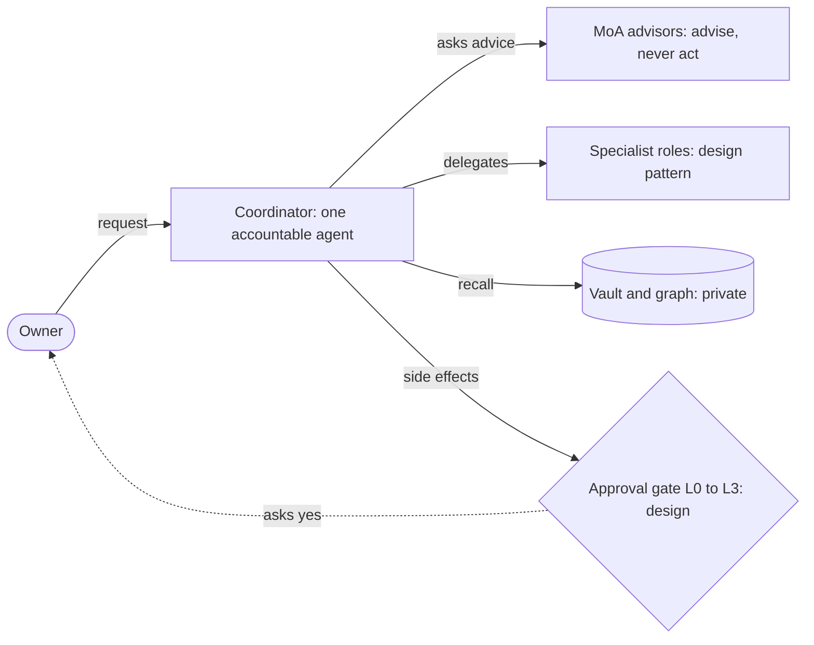

# kodros-moa-architecture

A written reference for engineers who design multi-agent systems that keep one accountable agent and a human approval step. It describes the mixture-of-agents (MoA) loop and a role-orchestration pattern, with diagrams.

Part of the [Kodros](https://kodros.ai) agent tooling. Documentation only: there is no code, no configuration and nothing to install or run.

## On your computer

- Does: nothing on its own. It is a design reference.
- Needs: no special computer. Any Markdown viewer and a browser that renders Mermaid (GitHub does).
- On-prem: the design is local-first. Data and inference stay on local computers where practical, and only the minimum context goes to an approved cloud model when one is used. The document describes this. It does not enforce it, because no code ships here.

## What is implemented and what is design

| Part | State | Where it lives |
| --- | --- | --- |
| MoA loop (advisors plus one acting aggregator) | Implemented and public | [Hermes Agent](https://github.com/NousResearch/hermes-agent), documented in [Mixture of Agents](https://hermes-agent.nousresearch.com/docs/user-guide/features/mixture-of-agents) |
| Coordinator with specialist roles | Design pattern | Kodros ran five named specialist roles in 2026 and no longer deploys them. The pattern is kept here as a reference. |
| Private Markdown vault with graph recall | In use at Kodros, private | Not published here |
| Approval levels L0 to L3 and append-only audit trail | Design intent | Not published here |
| Client apps | Pre-release | Not published here |

Everything outside the MoA loop describes how Kodros intends the system to behave. Nothing in this repository proves that behavior.

## How it works



Static diagram: [docs/architecture.svg](docs/architecture.svg). Read the long form in [docs/ARCHITECTURE.md](docs/ARCHITECTURE.md).

Many models can advise, but one agent acts. Advisors get a trimmed view of the task and no tools, so they cannot change anything. The coordinator checks specialist answers against live state before it trusts them. Anything that sends, publishes, pays or deletes stops at an approval gate that asks the owner first.

## Stack

Markdown and Mermaid. The static diagram is generated with Graphviz from `docs/architecture.dot`.

## Build

There is nothing to build. To redraw the static diagram:

```bash
dot -Tsvg docs/architecture.dot -o docs/architecture.svg
```

See [BUILD.md](BUILD.md).

## Limits

- Documentation only. The approval levels, the vault, the audit trail and the specialist roles are described, not shipped.
- The MoA runtime notes match the Hermes Agent source as of October 2026 and can drift.
- Hermes MoA does not stage actions for approval. The approval gate is Kodros's own design layer.

## License

Copyright 2026 Tanner Osterkamp. All rights reserved. See [LICENSE](LICENSE). The text is public to read; ask before reuse. Licensing contact: tanner@kodros.ai.
